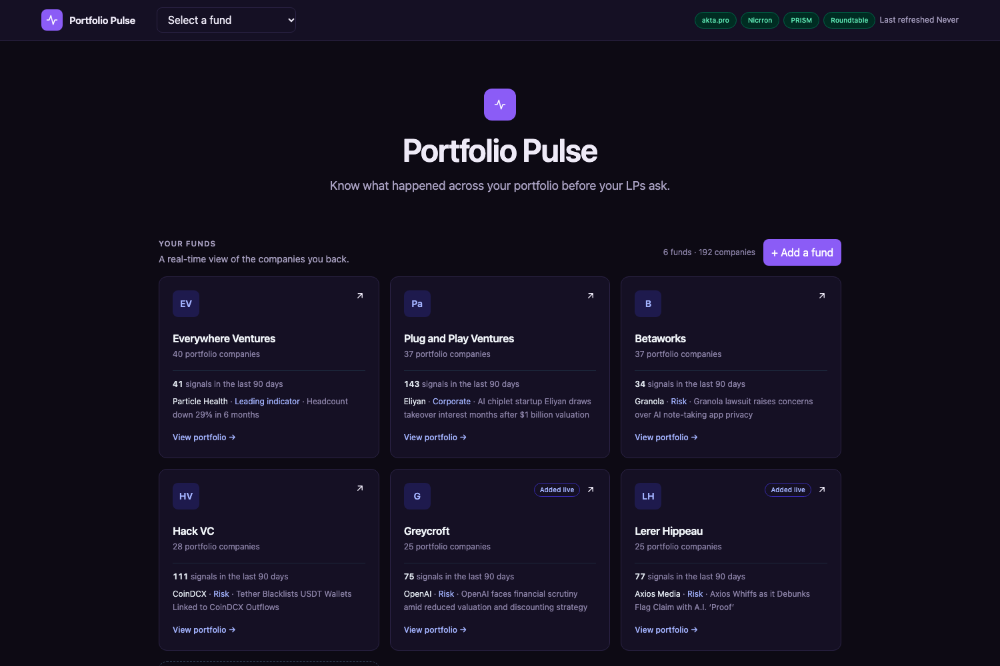
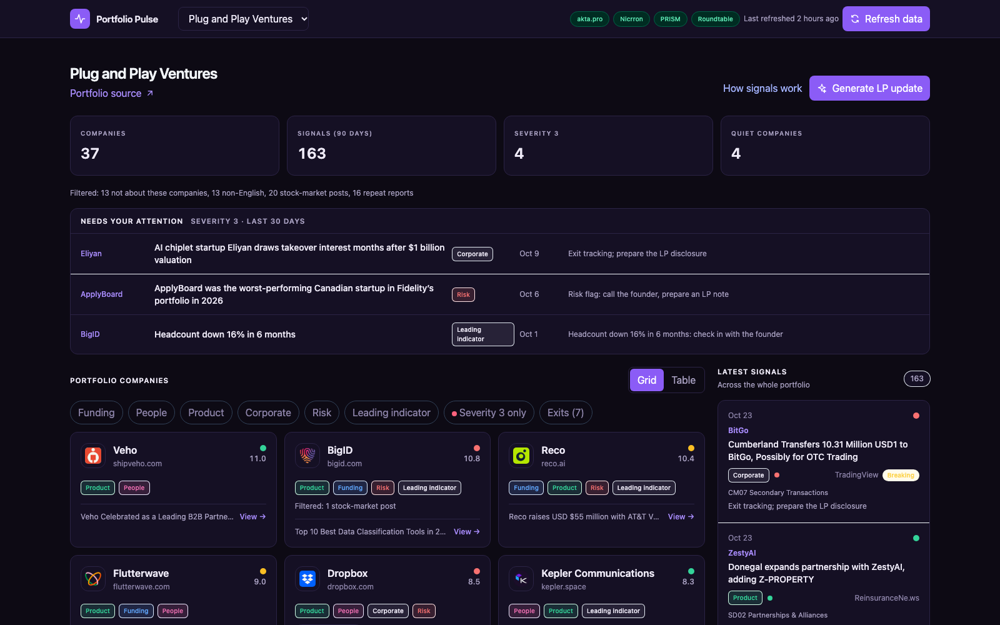
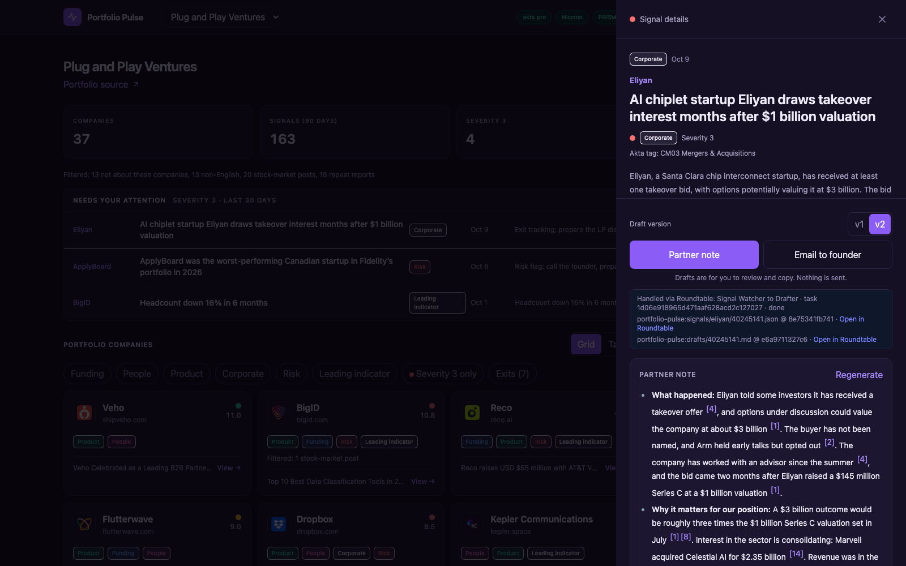
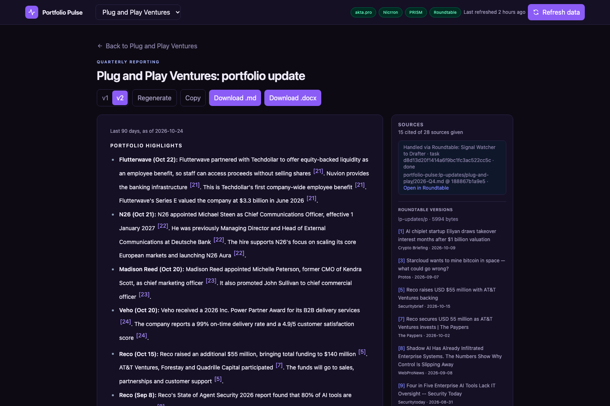
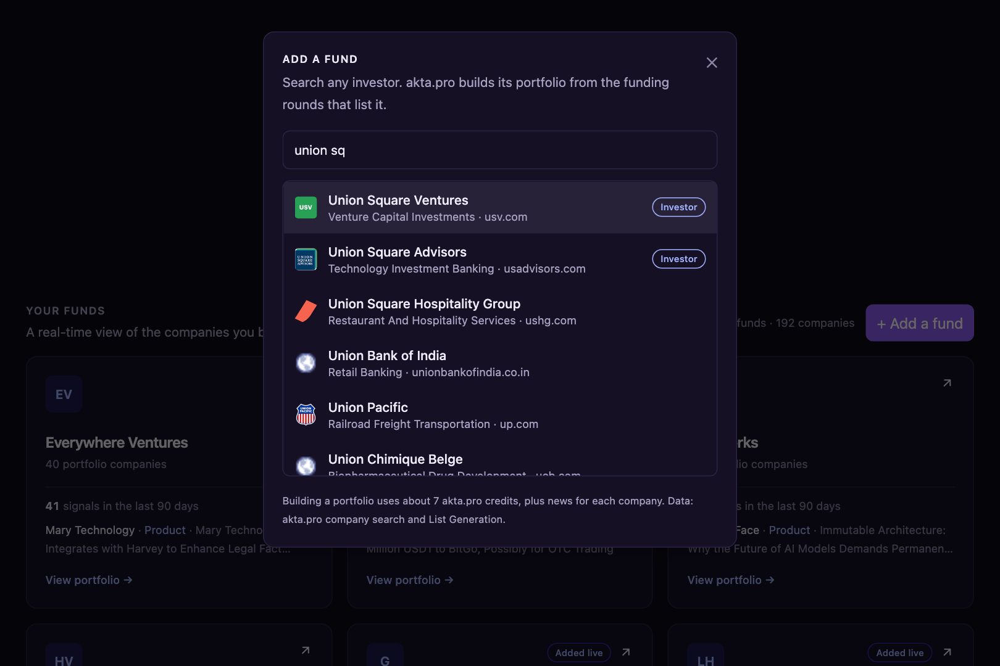
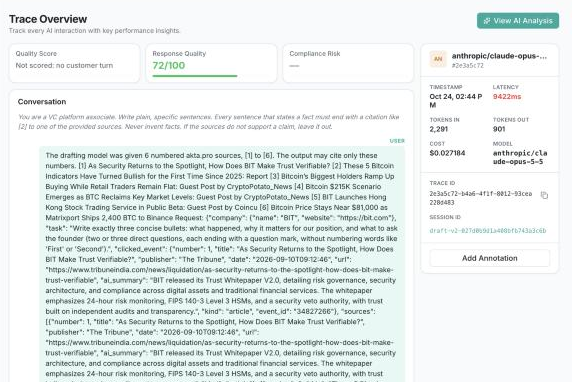

# Portfolio Pulse

Portfolio monitoring for venture funds: every portfolio company watched through public news and
company data, turned into ranked signals, drafted next moves and an LP update with every sentence
cited. Nothing sends itself.

- **Live app:** https://portfolio-pulse-portfolio-mo-193e.ninoo.app
- **Ninoo Marketplace:** https://market.ninoo.ai/a/portfolio-pulse
- **Roadmap:** [issue #1, from portfolio signals to fund management](https://github.com/happyc0der/portfolio-pulse-app/issues/1)

Built on October 24, 2026 at Deal Flow, NYC's VC hackathon at Betaworks (Track 3: Portfolio).



## What it does

- **Watches a fund's portfolio.** Four real portfolios are loaded (Everywhere Ventures, Plug and Play
  Ventures, Betaworks, Hack VC), and **any fund can be added live**: type an investor's name, akta.pro
  company search suggests it as you type, and akta.pro List Generation builds the portfolio from the
  funding rounds that list that investor (about 35 akta credits; news loads in about 45 seconds).
- **Turns news into signals with fixed rules, not a model.** akta.pro's event tags map to a category
  (Funding, People, Product, Corporate, Risk) with a severity from 1 to 3 and a suggested next move.
  Headcount data from akta.pro adds leading indicators (a drop of 5% or more in six months, or growth
  of 20% or more). Companies are ranked by a pulse score: the sum of severity, halving every 90 days.
- **Shows what needs attention today.** Severity 3 events from the last 30 days at companies that
  have not exited.
- **Drafts the partner's next move.** A three-bullet partner note (what happened, why it matters,
  what to ask the founder) or a short founder email with one concrete offer, written by Claude Opus
  5.5 through Nicrron from numbered sources. Every factual sentence cites a source; a check drops any
  sentence that cites nothing or cites a source the model wasn't given.
- **Writes the quarterly LP update** the same way, with highlights and the companies to watch,
  exported as Markdown or Word.

| | |
| --- | --- |
|  |  |
|  |  |

## How the triage decides

The rules live in `api/main.py` and are unit-tested in `api/test_signals.py`.

- **Severity 3 needs reported news that names the company in the headline.** Opinion pieces,
  explainers, listicles and industry stories that only mention the company drop to severity 2.
- **A passing mention asks for nothing.** A story that doesn't name the company in its headline is
  severity 1 with "Mentions the company in passing; no action needed" (an industry risk story stays
  at severity 2).
- **The action follows the story.** Positive news is amplified or congratulated, neutral news is
  noted for the next update, and bad news is never met with "Congratulate" or "Amplify it". A raise
  counts as the company's own only when the company comes before the raise in the headline.
- **One story, one signal.** Repeat reports of the same story within seven days are merged.
- **Noise is filtered and shown.** Articles not about the company, non-English articles and
  stock-market robo-posts are dropped and counted on each card.
- **Exits stay out of the attention list.** Public and acquired companies (from akta.pro, plus a short
  list of corrections with sources) are marked Exited.
- **The right company's data.** akta.pro company data is used only when its match has the company's
  own website.

## Architecture

```
akta.pro news, tags, headcount ──► filters (relevance, language, market posts, repeats)
                                          │
                                          ▼
                       signal rules (tag → category, severity, action) ──► fund page, attention list
                                          │
          numbered sources ──► Nicrron (Claude Opus 5.5) ──► citation check ──► draft / LP update
                                          │                                        │
                    PRISM: one trace per run                    Roundtable: Signal Watcher hands the
                    (request, source index, model call)        work to the Drafter as a task; the
                                                                Drafter files it and closes the task
```

- **Frontend:** React 19, Vite, TypeScript, Tailwind v4 (`src/`).
- **Backend:** Python FastAPI (`api/`): `main.py` (data, rules, drafts, LP updates), `citations.py`
  (the citation check), `tracing.py` (PRISM), `roundtable.py` (the Roundtable client).
- **Hosting:** Ninoo Builder publishes the app on ninoo.app. The hosted backend runs as several
  server instances with separate disks, so funds added live and every generated draft and LP update
  are stored in the team's Roundtable folder and shared by all instances. A committed snapshot
  (`api/data/snapshot/`) serves the four built-in funds right after each publish.

## Sponsor tools

| Tool | Where |
| --- | --- |
| **Ninoo Builder** | Built and hosts the app; listed on the Ninoo Marketplace. |
| **Nicrron** | Every model call goes through `https://api.nicrron.ai/v1` (`anthropic/claude-opus-5-5`). |
| **akta.pro by Wokelo AI** | News with event tags and sentiment, headcount trends, company search, List Generation. Every citation is an akta.pro article. |
| **PRISM by Block Convey** | One trace per draft and LP update: the run, an `akta_sources` step indexing every numbered source, and the model call with tokens and cost. PRISM's automatic review scores every trace. |
| **Roundtable** | Two agents with their own identities: the Signal Watcher saves the event and assigns a task; the Drafter claims it, saves the cited draft as a versioned file and closes the task. The same folder is the shared memory across server instances. |



## How it was checked

- 75 backend tests (`pytest api/`): signal rules, the citation check, news parsing, PRISM context,
  Roundtable parsing.
- Three QA agents tested the live app as a user, as a skeptical VC and on funds added live; their
  findings drove the final triage and reliability fixes.
- A live check on random items, not the demo path: LP updates for all four funds generated in 16 to
  22 seconds (the host allows 30); eight random drafts across all funds in 10 to 13 seconds each; a
  fund added live (Greycroft, 25 companies) was served by every server instance with its drafts and
  LP update working.

## Outcome and what's next

Portfolio Pulse did not win at Deal Flow. The judge said the project was good; the main feedback was
that it reports signals but doesn't help **manage the fund**. That is the next step, tracked in
[issue #1](https://github.com/happyc0der/portfolio-pulse-app/issues/1):

- **Fund management:** positions per company (ownership, cost basis, rounds), current marks and fund
  metrics (MOIC, IRR, TVPI/DPI), follow-on reserves, and an LP update that carries the numbers next to
  the news.
- A company profile panel loaded on demand (akta.pro firmographics, funding history, team trend).
- One shared akta.pro credit ledger: the 500-credit cap is counted per server instance today.
- Job-post data as a hiring signal, translation of non-English stories, and a full portfolio beyond
  the first 25 companies for funds added live.
- A PRISM evaluator that can separate the drafting versions: its judge reads about 2,000 characters
  of context, so it checks claims against short source summaries.

## Run it locally

```bash
pnpm install && pnpm dev                          # frontend on :5173 (proxies /api to :8000)
python3 -m venv .venv && .venv/bin/pip install -r api/requirements.txt
.venv/bin/uvicorn api.main:app --reload --port 8000
.venv/bin/python -m pytest -q api                 # tests
```

Environment variables (names only; keep values in `.env`, which is git-ignored): `AKTA_API_KEY`,
`NICRRON_API_KEY`, `PRISMTRACE_API_KEY`, `PRISMTRACE_PROJECT_ID`, `PRISMTRACE_HOST`,
`ROUNDTABLE_PROJECT`, `SIGNAL_WATCHER_KEY`, `DRAFTER_KEY`, `DRAFTER_ID`. Optional: `AKTA_CREDIT_CAP`
(default 150; 500 on the live site).

Helper scripts in `scripts/`: `check-live.py` (checks a deployed copy end to end), `prism-mcp.py`
(calls a PRISM MCP tool with `PRISM_MCP_KEY` from `.env.local`), `roundtable-setup.py` (creates the
two Roundtable agents).

## Repository layout

- `src/`: the web app. `api/`: the backend, tests and data (`api/data/funds.json`, the snapshot).
- `docs/screenshots/`: the images above. `docs/hackathon/`: the Devpost write-up, the demo video
  script, feedback we wrote for each sponsor tool, and the plan written before the event.
- `scripts/`: the helper scripts.

## How it was built

Built during the event, in Ninoo Builder from our prompts and in Claude Code through Ninoo Git, by
Keshav Rajput ([@happyc0der](https://github.com/happyc0der)). Before the event we did the research,
the product spec and the public portfolio lists.
